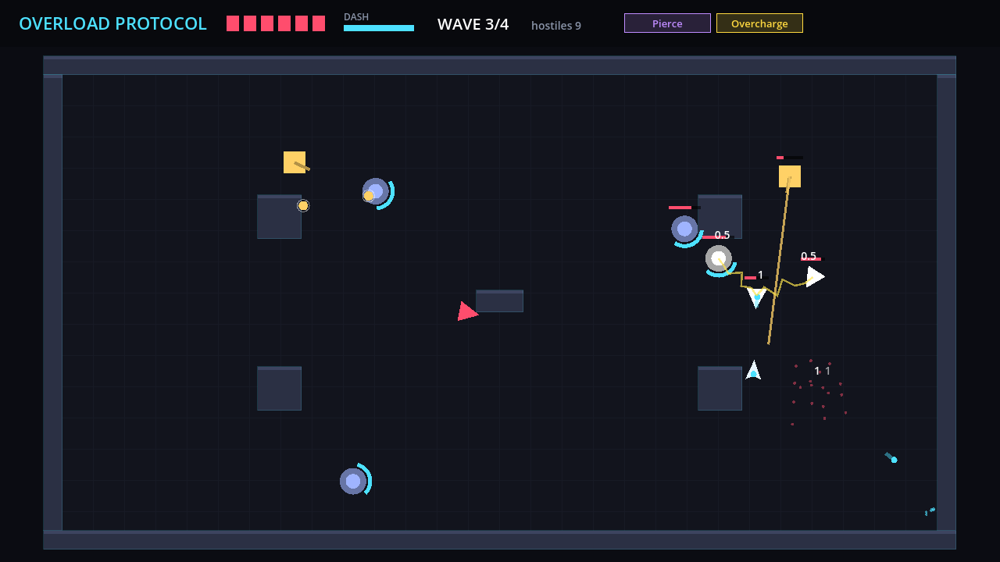
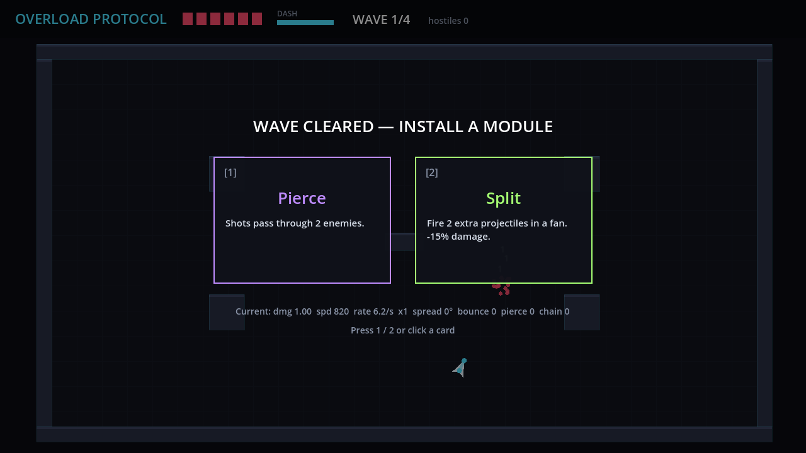
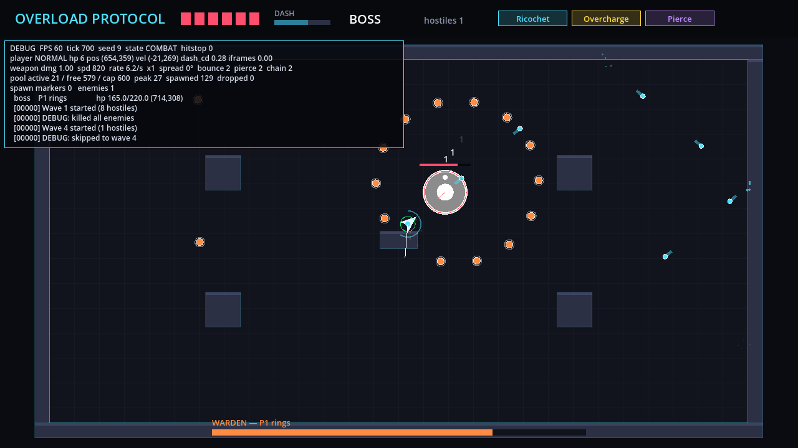

# Overload Protocol

**Top-down arena shooter with modular weapons — Godot 4.3+ · GDScript · playable in the browser**

Survive three waves and a three-phase mini-boss. After each wave you install one weapon module, and the modules combine: Ricochet + Pierce + Overcharge produces bullets that bounce off walls, pass through enemies and chain lightning to whoever is nearby.



> **Play:** _itch.io link here_ · **Controls:** WASD move · mouse aim · LMB / J fire · Space / Shift / RMB dash (invulnerable) · 1 / 2 pick a module · R restart · F1 debug overlay · F2 save replay

---

## What this project demonstrates

- **Real-time systems on a fixed tick.** Everything is simulated at a fixed 1/60 s step, driven by one `Game` node in a fixed order. A seeded RNG and recorded input make a whole run **reproducible**: F2 saves it, and `tools/replay.gd` plays it back headless and checks that the final state matches.
- **Engine-native physics used deliberately:** `CharacterBody2D` for actors, `StaticBody2D` for level geometry, named collision layers, and `PhysicsDirectSpaceState2D` ray queries for bullets.
- **Modular weapons as data:** each module is a `Resource` (`.tres`, the Godot equivalent of a Unity ScriptableObject). A single composition function, `WeaponSpec.compose()`, folds any combination of modules into the gun's stats. There is no `if ricochet and pierce...` anywhere in the code.
- **Object pooling:** 600 projectile slots are allocated once. There are no node allocations in combat, and every bullet is drawn in a single `_draw()` call.
- **Juice:** hitstop, screen shake, knockback, hit flash, floating HP bars, damage numbers, chain-lightning arcs and dash trails. Every spawn is telegraphed in advance.
- **QA tooling:** an F1 overlay that draws hitboxes, shield arcs and per-enemy FSM states, plus cheat keys, an autopilot bot, a soak test, acceptance scenarios, replays, and 39 headless tests running in CI.
- **A [`tasks/`](tasks/) folder** of bug-fix and feature challenges, written as they would be for AI-evaluation work.

## Architecture

```
scripts/
  core/      game.gd (clock + tick order), wave_director.gd, arena.gd,
             input_frame.gd / input_source.gd (live, scripted), autopilot.gd
  player/    player.gd: CharacterBody2D, movement, dash + i-frames, firing
  weapons/   weapon_module.gd (Resource), weapon_spec.gd (composition),
             module_library.gd, projectile_system.gd (pool + swept rays)
  enemies/   enemy.gd (base FSM), chaser, shooter, shield, warden (boss)
  fx/        fx_layer.gd: cosmetic-only effects with their own RNG stream
  ui/        hud.gd, debug_overlay.gd
resources/modules/   six WeaponModule .tres files
scenes/              main, player and one .tscn per enemy
tests/               headless runner + 39 tests (logic and physics)
tools/               soak, replay, scenario, capture
tasks/               bug and feature challenges
```

### Tick order (`Game.step`)

| # | Phase | Notes |
|---|-------|-------|
| 1 | Read one `InputFrame` | Read **every** physics frame, even during hitstop, so recordings stay aligned with ticks. A dash pressed during hitstop is buffered. |
| 2 | Hitstop | While frozen, the simulation tick is skipped and visuals keep animating. |
| 3 | Player | Movement with acceleration, dash, knockback, firing at the spec's fire interval (the leftover time carries over, so the rate is exact). |
| 4 | Director | Counts down spawn telegraphs, then spawns enemies. |
| 5 | Enemies | Each runs its AI (`_think`) and then `move_and_slide`, in spawn order. |
| 6 | Projectiles | Swept-ray collision; bounce, pierce and chain all resolve inside the same tick. |
| 7 | Contacts | Enemy body overlapping the player → damage plus contact recoil. |
| 8 | Wave flow | Cleared → pick an upgrade → intermission → next wave, or victory after the boss. |

### Enemies

| Enemy | Behaviour | What it tests in the player |
|-------|-----------|-----------------------------|
| **Chaser** | Runs straight at the player and steers around cover by following the surface of whatever blocks it | Spacing, knockback |
| **Shooter** | Keeps 210–330 px away and strafes. Telegraphs each shot for 0.45 s with the target **locked** at the start of the wind-up, then fires one slow bullet | Reading telegraphs, dodging |
| **Shield Bearer** | Frontal 120° shield that blocks shots, and Ricochet shots bounce off it. It turns at only 1.7 rad/s | Flanking: circle tight or dash through it |
| **Warden** (boss) | P1 rotating bullet rings → P2 aimed fans and summons → P3 telegraphed charges that fire a ring on wall impact. Invulnerable during each phase shift, and the shift clears its bullets | Everything |

### Weapon composition

```
spec = base
for module in modules: add the additive fields (projectiles, spread, bounces, pierce, chain)
spec.damage *= product(damage_mult) ... and the same for fire rate, speed, knockback
```

Sums and products commute, so the order modules are picked in never matters (`test_composition_is_order_independent`).

## Known edge cases handled

| Edge case | Solution | Covered by |
|-----------|----------|------------|
| Fast bullets tunnel through thin walls | Each tick casts a ray from the old position to the new one (continuous collision) | `test_fast_projectile_never_tunnels_through_thin_wall` |
| A ricochet ray starts **on** the wall it just hit | Step 0.5 px off along the surface normal before the next ray | `test_ricochet_reflects_off_wall`, `scenario ricochet_wall` |
| Point-blank shots: an enemy hugging the player contains the ray origin | Rays start at the body centre with `hit_from_inside = true` | `test_point_blank_shot_hits_enemy_overlapping_muzzle` |
| Recycled pool slots keep state from their previous life | `Projectile.reset()` clears every field, including the pierce exclusion list | `test_pool_slot_is_fully_reset_on_reuse`, `scenario pierce_boss` |
| Rays read a stale broadphase if the game is ticked outside a physics frame | The game only advances in `_physics_process`; tests and tools use a tick budget instead of calling `step()` directly | the whole physics test suite |
| Several test games colliding with each other | Each test game runs in its own `SubViewport`, which gives it its own `World2D` | `TestCase.add_isolated` |
| Two enemies spawned on the same point: depenetration pushes one through a wall | The spawn picker skips occupied points. As a safety net, enemies are clamped back inside the arena and a `WARN` is logged | soak test |
| Enemies stacking on top of the player | Contact recoil pushes the enemy away even when the player is invulnerable | soak test |
| Chasers stuck against the flat face of a pillar | `seek_dir()` follows the obstacle's surface toward the target | soak test |
| Ending a dash inside a bullet stream | The i-frames (0.24 s) outlast the dash (0.14 s) | `test_iframes_outlast_the_dash`, `scenario dash_ring` |
| Upgrade cards depending on how the player moved | Separate RNG streams for gameplay, upgrades and cosmetics | `test_upgrade_roll_is_seeded_distinct_and_skips_owned`, `test_cosmetic_rng_does_not_affect_gameplay` |
| Replays drifting | `InputFrame.to_array()` is lossless, with no rounding | `test_recorded_inputs_replay_exactly`, `tools/replay.gd` |
| `.tres` files are remapped in exported builds, so folder listings differ | Modules are listed with `preload()`, not discovered with `DirAccess` | `test_every_module_resource_loads` |

## Running it

```bash
godot --headless --path . --import

# Tests: 39 tests, about 2 s with --fixed-fps
godot --headless --fixed-fps 60 --path . --script res://tests/run_tests.gd

# Acceptance scenarios (exit code 0/1)
godot --headless --fixed-fps 60 --path . --script res://tools/scenario.gd -- ricochet_wall

# Soak: a full run with the autopilot bot (god = must reach victory)
godot --headless --fixed-fps 60 --path . --script res://tools/soak.gd -- 7 30000 god

# Replay a run saved with F2 (verifies the final state matches)
godot --headless --fixed-fps 60 --path . --script res://tools/replay.gd -- user://last_run.json --trace 600
```

**QA options:** `godot --path . -- --seed=24 --modules=ricochet,pierce` starts with a fixed seed and modules already installed. With F1 open: **F3** god mode, **F4** kill all, **F5** jump to the boss.

### Web export (itch.io)

*Project → Export → Web → Export Project*, then zip `build/web/` and upload it as an HTML game: 1280×720 viewport, SharedArrayBuffer support **off** (the preset uses the no-threads template).




## License

MIT
